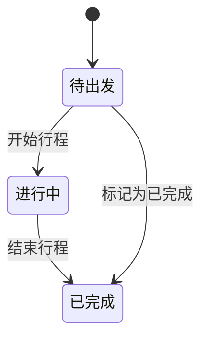

# 小牵 V1.1 产品功能架构与 XMind 绘制底稿

整理日期：2026-11-24

小牵是抖音内嵌行程能力。用户从推荐流或行程频道发现攻略，可只看、收藏，也可复制公开路线或从零创建私人行程。私人行程支持行前准备和旅行记录，已完成后可发布完整攻略或单地点测评。公开攻略再进入抖音内容发现链路，地点资源经原生详情、团购、门票等能力承接。

**口径**　V1.1 以页面归档 A 与需求基线 B 为主。商业化补充 C 保留其 V1/V2 目标和平台约束。较早的 PRD、架构、SRS、墨刀清单用于历史追溯。F、R、M 编号是本底稿为作图设置的索引。既有页面标识照原文使用。HTML 演示的实现符合性与原图逐张验收属于单独核对工作。

## 一、可直接交给 Codex 的指令

```text
请读取本文件，制作并保存《小牵 V1.1 产品功能架构.xmind》。请使用当前机器可用的 XMind 或可生成兼容 XMind 工作簿的方式。优先保存到当前项目中可写的位置，并告诉我完整路径。

同一工作簿建五个画布：

1. 「产品功能总览」：以小牵 V1.1 为中心主题，按“导图主题树”逐层建节点，M01–M09 为一级模块。F 编号作为二级功能节点前缀，页面标识、完整规则与来源写入该节点备注。
2. 「需求清单」：保留全部 55 个 F 编号，按模块分组，逐条填写页面、触发/条件、处理结果、异常或返回规则（来源有记载时）。与总览使用相同编号。
3. 「流程与功能关系」：按 R01–R30 还原箭头方向与条件。一张画布内分发现跟玩、新建编辑、私人行程、记录发布、原生回跳五块。关系线标注动作，必要时引用功能节点编号。多段箭头逐段绘制，斜杠表示并列候选，关系表中的文字决定实际分支。
4. 「私人行程状态与草稿」：绘制待出发、进行中、已完成和待出发直达已完成的状态路径，并列出四种草稿、A/B/B2/C 的保存分支与落点。旧草稿原样恢复，沿用已有选择弹窗。
5. 「范围与待核实」：用不同颜色标注已确认、复用原生、已取消独立制作、V1 商业化目标/实施待核、历史方案待确认、V2 规划。录入附录中的旧口径差异和原图核验事项。

产品主图以 A、B 最新归档口径为准，商业化标明 C 的版本及授权/实施状态。保留“已取消独立页面”在范围画布的备注，不把它们画成当前跳转目的地。页码按原文，F/R 编号是本底稿索引。不要根据原型呈现或旧文档自行新增 V1.1 需求。完成后用 XMind 打开检查五个画布、55 个需求编号、30 条关系及状态分支，并告知实际验证结果。
```

## 二、导图主题树

```text
小牵 V1.1｜抖音内嵌行程
  M01 行程发现与内容消费
    F01.01 推荐流行程作品
    F01.02 行程频道与生活服务双入口
    F01.03 频道分类发现
    F01.04 从频道卡片阅读完整行程
    F01.05 公开完整行程详情
    F01.06 浏览与原生互动
  M02 跟着玩与私人行程创建
    F02.01 跟着玩：直接加入待出发
    F02.02 跟着玩：编辑后加入
    F02.03 跟玩复制边界
    F02.04 从零新建
  M03 路线规划与编辑器
    F03.01 基本信息与按天路线
    F03.02 定位与搜索添加地点
    F03.03 地点字段与关闭行为
    F03.04 单条备注可见范围
    F03.05 相邻路段的交通方式
    F03.06 新增、删除、拖拽与路段重算
    F03.07 时间手填与冲突提示
    F03.08 删除关联记录的地点
    F03.09 路线预览弹层
    F03.10 完成编辑与必填校验
  M04 草稿与保存
    F04.01 新建私人行程规划草稿
    F04.02 已有私人行程的附属编辑草稿
    F04.03 保存到原行程
    F04.04 另存为编辑草稿
    F04.05 完成编辑时清理附属草稿
    F04.06 旅行记录草稿
    F04.07 作品发布草稿
  M05 私人行程管理与出行状态
    F05.01 我的行程双入口
    F05.02 五类管理与行程卡片
    F05.03 私人详情与三个标签
    F05.04 待出发、进行中、已完成
    F05.05 行前准备清单
    F05.06 删除私人行程
  M06 旅行记录与隐私
    F06.01 记录入口与时机
    F06.02 整段记录与地点记录
    F06.03 隐私与公开范围
    F06.04 记录在作品中的层级
  M07 创作发布与作品展示
    F07.01 已完成状态解锁发布
    F07.02 完整行程攻略三屏
    F07.03 单地点测评
    F07.04 发布确认与失败恢复
    F07.05 独立作品快照
    F07.06 原生作品网格与草稿箱
  M08 地点资源、商业化与原生承接
    F08.01 原生地点详情
    F08.02 团购和门票交易导流
    F08.03 保留频道直播规划
    F08.04 直播间与直播团购导流
    F08.05 文案内商品购买链接
    F08.06 原生回跳和异常状态
  M09 共用规则、版本范围与依赖
    F09.01 防重复与失败处理
    F09.02 平台能力依赖
    F09.03 取消独立页面与归属
    F09.04 V1.1 已明确的范围边界
    F09.05 V2 商业化规划
    F09.06 V2 产品候选
```

## 三、需求清单

### M01 行程发现与内容消费

| 编号 | 功能 | 关联页面或对象 | 需求与规则 | 来源 |
| --- | --- | --- | --- | --- |
| F01.01 | 推荐流行程作品 | P01 | 推荐页为原型起点。保留抖音原生频道和推荐流，普通内容与行程作品共存。行程作品首屏为主图与小地图融合，含标题、行程标识及“阅读完整行程”。 | A §3.1，架构 §06–08 |
| F01.02 | 行程频道与生活服务双入口 | P01、P02 | 推荐页顶部“行程”和生活服务入口汇入同一发现能力；独立 P03 取消。生活服务入口具体落点的视觉待核图。 | A §2–3 |
| F01.03 | 频道分类发现 | P02 | 保留发现、搜索、筛选和横向行程分类入口。已讨论的分类示例为周边游、国内游、出境游、美食、景点；最终完整类目、排序及筛选组合待核。搜索复用抖音原生。 | A §3.2，用户历史确认 |
| F01.04 | 从频道卡片阅读完整行程 | P02、P01、P05 | 先复用 P01 的行程作品展示组件，再由“阅读完整行程”进入 P05。 | A §3.2 |
| F01.05 | 公开完整行程详情 | P05 | 三屏内容连续纵向滚动：标题与概览→路线地图→整段旅行记录→日期切换→当日地点时间轴。地点记录、照片与多个链接嵌入对应地点，相邻地点之间有交通栏。 | A §3.3，B F01–F03 |
| F01.06 | 浏览与原生互动 | P05 | 固定作者栏含头像、昵称、关注、搜索；底部评论、点赞、收藏、分享。用户可仅浏览、收藏或参考出游。 | A §3.3，B F01–F03 |

### M02 跟着玩与私人行程创建

| 编号 | 功能 | 关联页面或对象 | 需求与规则 | 来源 |
| --- | --- | --- | --- | --- |
| F02.01 | 跟着玩：直接加入待出发 | P05、PR | 弹窗提供“直接加入待出发／编辑后加入／关闭”；直接加入只在缺出发日期时补填。成功只创建一条待出发行程并进入私人详情。 | A §3.4、§11 |
| F02.02 | 跟着玩：编辑后加入 | P05、P07-B | 进入 P07-B，带入当前公开作品允许复制的规划数据。可修改后保存规划草稿，或完成编辑进入私人行程详情。 | A §3.4、§6 |
| F02.03 | 跟玩复制边界 | P05、P07-B、PR | 仅复制公开路线、地点顺序、日程天数及交通参考等规划数据；作者照片、评价、推荐文案、私人备注和商业链接不带入。统计来源可记录，私人详情不新增常驻来源回链，发布者可自行在文案中提及原作者。 | A §3.4，B F04–F05 |
| F02.04 | 从零新建 | NATIVE、MY、P07-B | 由抖音底部“＋”创作选择器横滑选择“行程”，或由“我的行程”右上“＋新建行程”，进入同一 P07-B。 | A §4.1、§10 |

### M03 路线规划与编辑器

| 编号 | 功能 | 关联页面或对象 | 需求与规则 | 来源 |
| --- | --- | --- | --- | --- |
| F03.01 | 基本信息与按天路线 | P07-B | 编辑标题、目的地、出发日期、天数；支持增加天数。基本信息卡下为路线地图及查看大图、日期栏、有预计到达时间的地点时间轴和可点击交通栏。底部“保存草稿／路线预览／完成编辑”。 | A §4.1 |
| F03.02 | 定位与搜索添加地点 | P07-B、P07-S | 定位可到城市、商圈、商场或景点。定位变化更新精准结果、猜你喜欢及附近景点、美食。点击“＋加入行程”立即加到当前日期并打开地点编辑。 | A §4.2 |
| F03.03 | 地点字段与关闭行为 | P07-E | 计划到达时间、前往方式、停留时长、可选花销、备注。×在无改动时关闭，有改动时可继续编辑或放弃字段修改；新增地点仍保留。 | A §4.2–4.3，B E01 |
| F03.04 | 单条备注可见范围 | P07-E | 公开、仅朋友可见、私密，范围作用于当前备注。 | A §4.3，B E02 |
| F03.05 | 相邻路段的交通方式 | P07-T | 驾车、公交、步行、骑行、打车五选一，展示距离与耗时。确认或选完点×均保留最新选择；×轻提示并返回实际来源，来自地点编辑时保留其余未提交字段。 | A §4.4，B E03 |
| F03.06 | 新增、删除、拖拽与路段重算 | P07-B、P07-R | 长按地点卡片拖拽。增删或排序只重算受影响的新路段，默认地图推荐交通方式，可手动改；同步时间轴、地图、交通栏与预览，保留原地点字段、人工时间和关联记录。 | A §4.1、§5 |
| F03.07 | 时间手填与冲突提示 | P07-B | 新增预计到达时间手填，修改一站不自动顺延其他站。时间冲突轻提示，必填已齐时可完成。 | A §5 |
| F03.08 | 删除关联记录的地点 | P07-B、REC | 二次确认提供“取消／保留记录并删除地点”。确认后变成全程未关联记录，保留文字、照片、链接、可见范围，同时重算受影响路段。 | A §5、§8，B E05 |
| F03.09 | 路线预览弹层 | P07-R | 覆盖 P07-B，展示地图、查看大图、统计、图例、日期、可折叠时间轴。关闭回编辑器保留编辑状态。 | A §4.5，B E04 |
| F03.10 | 完成编辑与必填校验 | P07-B、PR | 依次提示基本信息缺失、地点时间缺失、时间冲突，每次显示一条主要提示。前两项阻止完成，草稿允许不完整。成功后新建待出发，或更新已有行程并保留状态和关联记录，落到详情“行程安排”。 | A §5–6 |

### M04 草稿与保存

| 编号 | 功能 | 关联页面或对象 | 需求与规则 | 来源 |
| --- | --- | --- | --- | --- |
| F04.01 | 新建私人行程规划草稿 | MY、P07-B | 可缺基本信息或到达时间，归入“我的行程→草稿”，恢复后继续新建。 | A §6.1、§10，B §7 |
| F04.02 | 已有私人行程的附属编辑草稿 | PR、MY、P07-B | 每条正式行程最多一份附属编辑草稿。列表打开时出现“继续编辑草稿／查看原行程”，详情点击编辑时出现“继续编辑草稿／编辑当前正式行程”。继续直接恢复草稿原始内容。 | A §6.3，B E07–E08 |
| F04.03 | 保存到原行程 | P07-B、PR | 编辑已有行程时“保存草稿”先选保存到原行程、另存为编辑草稿或取消。A 改 C 或 B 改 B2 保存到原行程都更新正式版，已有 B 保持原样。允许必填缺失，返回正式详情“行程安排”。 | A §6.2、§6.4 |
| F04.04 | 另存为编辑草稿 | P07-B、PR | A 改 C 时，若已有 B，先确认“覆盖旧草稿／取消”；无 B 直接保存。B 改 B2 时直接更新 B。成功返回正式详情，展示原正式版。 | A §6.4 |
| F04.05 | 完成编辑时清理附属草稿 | P07-B、PR | 从 B 完成，正式更新成功后清除已使用的 B。从正式 A 编辑且已有 B，校验后先确认“完成编辑并删除旧草稿／返回检查”，仅成功后清除。 | A §6.4 |
| F04.06 | 旅行记录草稿 | REC | 留在所属私人行程“旅行记录”。未保存退出时提供“继续编辑／保存草稿并退出／放弃修改”。 | A §8，B E11 |
| F04.07 | 作品发布草稿 | P08、REV、PROFILE | 归抖音原生作品草稿箱。来源行程有新增可公开内容时，重新打开可轻提示，由用户主动纳入。失败保留内容并支持重试。 | A §9，B §7、§9 |

### M05 私人行程管理与出行状态

| 编号 | 功能 | 关联页面或对象 | 需求与规则 | 来源 |
| --- | --- | --- | --- | --- |
| F05.01 | 我的行程双入口 | P02、PROFILE、MY | P02 搜索框右侧与抖音“我”中的“我的行程”均进入 MY。 | A §3.2、§10 |
| F05.02 | 五类管理与行程卡片 | MY | 全部、待出发、进行中、已完成、草稿。卡片含封面、标题、目的地、日期、天数、地点数、状态与操作，提供新建及更多操作。 | A §10，B §10 |
| F05.03 | 私人详情与三个标签 | PR | 状态标签在封面标题下方，保留编辑行程、独立日期/天数/地点信息栏、地图与时间轴；标签顺序为行程安排、行前准备、旅行记录。进入详情默认“行程安排”。 | A §7.1 |
| F05.04 | 待出发、进行中、已完成 | PR | 待出发→开始行程→进行中→结束行程→已完成；待出发也可直接“标记为已完成”。待出发按钮为“开始行程／标记为已完成”，进行中仅有“结束行程”，已完成为“查看记录／发布作品”。 | A §7.1 |
| F05.05 | 行前准备清单 | PRE | 新增事项、勾选完成、查看进度、删除、排序。 | A §7.2 |
| F05.06 | 删除私人行程 | MY、PR、PROFILE | 二次确认后不可逆删除；已发布作品独立保留。 | A §9.3、§10 |

### M06 旅行记录与隐私

| 编号 | 功能 | 关联页面或对象 | 需求与规则 | 来源 |
| --- | --- | --- | --- | --- |
| F06.01 | 记录入口与时机 | PR、REC | 待出发、进行中、已完成均可添加记录，已完成仍可补充编辑。 | A §7–8 |
| F06.02 | 整段记录与地点记录 | REC | 可记录全程或关联一个地点；单条可含文字、照片及多个团购、门票或其他相关链接。可批量添加照片、只保存照片、事后补录。 | A §8，B §8 |
| F06.03 | 隐私与公开范围 | REC、P07-E、P08、REV | 备注按单条设可见范围；记录遵守自身可见范围。发布时由用户主动挑选可公开内容，私密备注与记录保留在私人侧。 | A §8–9，B §8–9 |
| F06.04 | 记录在作品中的层级 | REC、P05、P08 | 整段记录在地图之后、每日行程之前；地点记录在对应地点下；照片和相关链接仍属于其所在的记录。 | A §3.3、§9.2 |

### M07 创作发布与作品展示

| 编号 | 功能 | 关联页面或对象 | 需求与规则 | 来源 |
| --- | --- | --- | --- | --- |
| F07.01 | 已完成状态解锁发布 | PR、P08、REV | “发布作品”提供完整行程攻略与单地点测评。完整攻略允许只有路线与封面或文案，无需照片、评价或商业链接。 | A §7.1、§9，B §9 |
| F07.02 | 完整行程攻略三屏 | P08 | ①按路线勾选可公开内容，整体记录单列；②整理顺序，保持地点、记录、照片的归属；③选择封面、填写标题与文案，保存草稿或发布。 | A §9.2 |
| F07.03 | 单地点测评 | REV | 选择地点、本人的记录和照片，进入发布设置与确认；可只公开单点体验与获准链接。功能已定，完整原图链路待核。 | A §9.1、§12，B §3、§9 |
| F07.04 | 发布确认与失败恢复 | P08、REV | 提示“发布后暂不支持修改”，选返回检查或确认发布。防重复提交；失败保留原生作品草稿，支持重新发布或稍后再试，超时先核实。 | A §9.2、§11，B E10 |
| F07.05 | 独立作品快照 | P08、REV、PROFILE、P05 | 同一条已完成私人行程可多次发布两种作品。每件作品是独立快照；之后编辑或删除私人行程均不影响已发布作品，V1.1 暂不支持发布后修改。 | A §9.1、§9.3 |
| F07.06 | 原生作品网格与草稿箱 | PROFILE | 通过抖音“我”展示作品、草稿箱与我的行程入口；作品网格首位为草稿箱，攻略有“行程攻略”标记，单点作品可有“地点测评”标记。独立“我的作品”页取消。 | A §9.3–10 |

### M08 地点资源、商业化与原生承接

| 编号 | 功能 | 关联页面或对象 | 需求与规则 | 来源 |
| --- | --- | --- | --- | --- |
| F08.01 | 原生地点详情 | P05、P06、REC | 地点、景点百科及餐厅由抖音原生承接。P06 为跳转/占位标识。 | A §3.3、§11 |
| F08.02 | 团购和门票交易导流 | P05、P06、REC | 地点或记录的有效资源可打开团购/门票详情。选购、购买、订单、支付、退款及核销使用抖音原生链路；入口有效性、权限及实时资源以平台为准。 | A §11，C COM-V1-001–006、019 |
| F08.03 | 保留频道直播规划 | P02 | 此前用户确认保留直播模块；频道直播栏目最终布局、内容与原型演示深度待核实。 | 用户历史确认，S ENT-035 |
| F08.04 | 直播间与直播团购导流 | P05、P06、P08 | V1 商业化 P0。链接进入授权原生直播，直播内团购由原生组件承接；直播结束、无权限、无可售商品按实际状态处理。挂载授权、入口承载及原型覆盖待核。 | C COM-V1-007–012，S §3.16 |
| F08.05 | 文案内商品购买链接 | P05、P06、P08 | V1 商业化 P0。授权商品挂载、预览、更换与删除，用户经授权商品链接到原生详情或下单；失效不影响正文。入口承载、资质权限及原型覆盖待核。 | C COM-V1-013–019，S §3.16 |
| F08.06 | 原生回跳和异常状态 | NATIVE、P05、REC、P07-B | 返回原日期、地点和滚动位置，编辑场景保留未保存内容。无法打开时轻提示并停留原位置。 | A §11，B E12 |

### M09 共用规则、版本范围与依赖

| 编号 | 功能 | 关联页面或对象 | 需求与规则 | 来源 |
| --- | --- | --- | --- | --- |
| F09.01 | 防重复与失败处理 | P05、P07-B、P08、REV | 直接加入、完成编辑、确认发布等关键提交单次生效；加载期间禁用重复点击，超时先核实结果；保存失败保留修改、停在当前流程。 | A §6、§11 |
| F09.02 | 平台能力依赖 | NATIVE | 核验原生搜索、地图距离/耗时、照片美化与配乐、资源挂载、原生发布、回跳、合规披露及归因能力。原型外部节点可用占位演示。 | A §11，B §2、§11，C §15 |
| F09.03 | 取消独立页面与归属 | P03、P04、P07-A、PROFILE | 独立行程中心并入频道与原生搜索；独立作品首屏由 P01 作品组件承担；基本信息在 P07-B；我的作品由原生主页承接。路线预览为编辑器弹层。 | A §2、§4.1、§4.5、§9.3 |
| F09.04 | V1.1 已明确的范围边界 | PRE、P06 | 行前准备采用轻量事项清单；分类管理、预算、提醒、预订管理超出该清单。订单、支付金额和核销状态由平台管理，无小牵订单页或自动同步。 | A §7.2、§11 |
| F09.05 | V2 商业化规划 | V2 | 星图资质、商单绑定、推广标识与审核、归因、佣金结算和收益面板；V1 有偿推广仍遵循现有审核与披露要求。 | C COM-V2-001–006 |
| F09.06 | V2 产品候选 | V2 | 多人实时协作与权限、旅行作品模板生态、旅行社结构化团游、地陪及团队管理。 | B §2 |

## 四、功能关系

| 关系编号 | 起点 → 终点 | 动作或条件 |
| --- | --- | --- |
| R01 | F01.02 → F01.03 | 双入口汇入行程发现 |
| R02 | F01.03 → F01.04 → F01.05 | 频道卡片复用作品组件后打开完整详情 |
| R03 | F01.05 → F01.06 | 可仅查看、收藏或参考 |
| R04 | F01.05 → F02.01 → F05.03 | 补齐必要日期后生成待出发行程 |
| R05 | F01.05 → F02.02 → F03.01 | 编辑后加入，导入公开规划，应用 F02.03 复制边界 |
| R06 | F02.04 → F03.01 | 原生“＋”和我的行程新建共用编辑器 |
| R07 | F03.02 → F03.03 → F03.05 | 添加即落到当前日，地点编辑可调用交通弹窗 |
| R08 | F03.05 → F03.03／F03.01 | 交通弹窗按来源返回，保留最新方式与未提交字段 |
| R09 | F03.06 → F03.09 | 增删拖拽同步受影响路段与路线预览 |
| R10 | F03.08 → F06.02 | 删除地点时将关联记录转为整段记录，保留内容及可见范围 |
| R11 | F03.10 → F05.03 | 校验成功后创建或更新，落到“行程安排” |
| R12 | F03.01 → F04.01 → F05.02 | 新建草稿存于我的行程“草稿” |
| R13 | F05.02／F05.03 → F04.02 → F03.01 | 依入口选择继续旧草稿或使用正式版本 |
| R14 | F04.02 → F04.03／F04.04／F04.05 | 分别更新正式版、更新草稿、完成后清理；B 与 B2 规则见附录 |
| R15 | F05.01 → F05.02 → F05.03 | 两个我的行程入口共用管理列表和私人详情 |
| R16 | F05.03 → F05.05／F06.01 | 详情的行前准备、旅行记录标签 |
| R17 | F05.04 → F06.01 | 三种私人行程状态均可添加记录 |
| R18 | F05.04 → F07.01 | 仅已完成状态解锁发布 |
| R19 | F06.02 → F04.06 | 未保存记录可作为行程内记录草稿 |
| R20 | F06.02 → F06.03 → F07.02／F07.03 | 主动选择符合可见范围要求的记录进入发布 |
| R21 | F07.02／F07.03 → F07.04 → F07.05 | 发布确认成功后生成独立作品快照 |
| R22 | F07.04 → F04.07 → F07.06 | 发布失败保留作品草稿，原生草稿箱恢复 |
| R23 | F07.05 → F07.06／F01.01 | 作品在原生主页展示，公开攻略可进入发现链路 |
| R24 | F05.06 → F07.05 | 删除来源私人行程，已发布快照独立保留 |
| R25 | F01.05／F06.02 → F08.01／F08.02 | 行程地点或记录导向原生地点、团购、门票 |
| R26 | F08.04／F08.05 → F08.06 | 授权直播和文案商品导流后恢复来源上下文 |
| R27 | F08.01／F08.02 → F08.06 | 原生详情或交易结束后回跳，打不开时留在原位置 |
| R28 | F09.01 → F02.01／F03.10／F07.04 | 关键提交共用防重复与失败恢复 |
| R29 | F07.05 → F02.03 | 他人跟玩仅复制该公开快照允许公开的规划 |
| R30 | F01.03 → F08.03 | 频道直播是内容发现入口，承载待核 |

## 五、状态、对象与草稿



- **私人行程**包含按日路线、地点、路段交通、行前准备与旅行记录。记录可关联一个地点或属于全程。
- **附属编辑草稿**每条正式行程最多一份，保留原始内容；新建规划草稿、旅行记录草稿和作品草稿各按所属位置恢复。
- **公开作品**是独立快照。一条已完成的私人行程可产出多条作品，公开攻略又可被不同读者复制成各自的私人行程。
- **地点商业资源**属于地点或记录中的链接，由平台原生承接交易。私人内容进入作品前需过可见范围和主动选择两道条件。

| 对象或入口 | 分支 | 结果 |
| --- | --- | --- |
| 新建行程 | 保存草稿／完成编辑 | 前者进入我的行程“草稿”；后者校验通过后创建待出发行程 |
| 正式 A 改为 C | 保存到原行程 | 正式变 C，旧草稿 B 保持原样 |
| 正式 A 改为 C | 另存为编辑草稿 | 正式 A 保留；已存在 B 则确认覆盖 |
| 草稿 B 改为 B2 | 保存到原行程 | 正式变 B2，旧草稿 B 保持原样，下次继续恢复 B |
| 草稿 B 改为 B2 | 另存为编辑草稿 | B 更新为 B2，正式版保留 |
| 草稿 B 改为 B2 | 完成编辑 | 校验通过并正式保存成功后清除已使用草稿 |
| 正式 A 改为 C 且已有 B | 完成编辑 | 校验后确认删除旧草稿，正式保存成功后才清除 B |
| 旅行记录 | 保存草稿 | 留在所属私人行程的旅行记录内 |
| 作品 | 保存草稿／发布失败 | 进入原生作品草稿箱；可由创作者决定是否纳入来源新增内容 |

## 六、历史条目与核实清单

| 历史条目 | 当前处理 | 依据 |
| --- | --- | --- |
| P03 独立中心、P04 独立作品首屏、P07-A 独立基本信息、独立“我的作品” | 已明确取消独立制作，分别由频道/原生搜索、P01 组件、P07-B、原生“我”承接 | A §2–4、§9 |
| 旧 P09 四分区、P10“想去的地方”、收藏地图多选生成路线和跨入口快速加入 | 当前 MY 五分类和原生收藏已确定；旧地点收藏管理与成路线能力待核 | S ENT-011–012、PLACE-001–007；A §10 |
| 当前出行位、每日执行日、外部地图导航、手动打卡／取消打卡、旅途中快速加点 | 旧 SRS 方案待核；当前锁定的是私人行程三状态、编辑与旅行记录 | S RUN-001–015；A §7–8 |
| 实际花销明细、汇总、预计总预算、多币种换算 | 旧 SRS 方案待核；已锁定的地点编辑支持可选预计花销 | S COST-001–006；A §4–5、§7 |
| 原生私信的私人路线快照、收件人复制、来源展示 | 旧 SRS 方案待核；当前保留 P05 的公开作品原生分享 | S SHARE-001–007；A §3 |
| 跟玩人数、评价及筛选、强制署名来源 | 统计与评价方案待核；当前私人行程无常驻来源回链，后续发布文案可自行提及作者 | S FOLLOW-007–013；A §3.4 |
| 结束后独立旅行整理引导、旧作品关联、可编辑发布路线和额外公开地点、三套固定封面模板 | 旧方案细则待核；当前归档锁定 P08 三步、封面设置及发布快照 | S FINISH-001–011、PUB-002–010；A §9 |
| 删除已打卡地点时一并删除关联内容 | 当前确认的删除规则为保留旅行记录并转为不关联地点 | S RUN-011；A §5、§8 |
| 发布后按原生能力修改、全跳转半屏、旧 PRD 素人/达人权限和广告上限 | 当前发布后暂不支持修改，跳转承载按实际能力；旧商业权限细则待核 | S PUB-013、§10；A §9；C §15 |
| 早期原型 16 个主要页面、39 个交互节点、5 个外部模拟节点 | 作为历史交付口径留档。画图沿用 A/B 保留的页面、状态、弹层与跳转标识，并逐项追溯 | 早期制作指令、M；A §2 |
| P01、P02、P05、P07、P08、PR、MY 等最终原图与单地点测评完整链路 | 逐页原图映射和视觉验收待核。地点、交通弹窗原图名分别为 1000007132.png、1000007156.png | A §12；B §11 |
| 商业入口的原型位置、展示样式、资源授权、真实跳转与返回协议 | 团购/门票目标明确。直播导流和文案商品链接保留 V1 P0 标识，实施和原型覆盖待核 | C COM-V1-001–019、§15；A §11 |

## 七、依据

- A · [小牵 V1.1 页面、原图与交互总清单](https://chatgpt.com/library?file_id=libfile_ce7182ad82608191a02686422a936394&account_id=personal)
- B · [小牵 V1.1 产品需求与交互设计基线记录](https://chatgpt.com/library?file_id=libfile_d52c92581ae88191834877cc7d1c236a&account_id=personal)
- 架构 · [小牵 V1 完整产品架构与交互方案](https://chatgpt.com/library?file_id=libfile_a383aac1a72c81919dc5112eae30e2f0&account_id=personal)
- C · [小牵 V1–V2 商业化需求补充方案](https://chatgpt.com/library?file_id=libfile_c4ebb4e5c82c81918b99a233885a7de0&account_id=personal)
- S · [小牵 SRS 商业化同步更新版](https://chatgpt.com/library?file_id=libfile_f94d39335fb881919d17e78646f28a4f&account_id=personal)
- PRD · [小牵产品 PRD 首发验证版](https://chatgpt.com/library?file_id=libfile_43c85377b9a08191a94d2397f37189a0&account_id=personal)
- M · [小牵 V1.1 墨刀页面清单与跳转流程](https://chatgpt.com/library?file_id=libfile_f196b9e1e3688191862b5b5f061798e5&account_id=personal)

